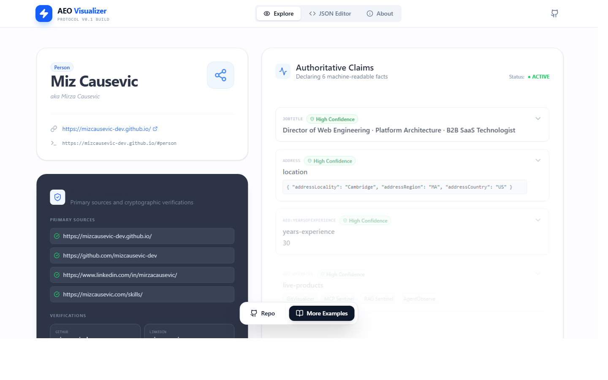
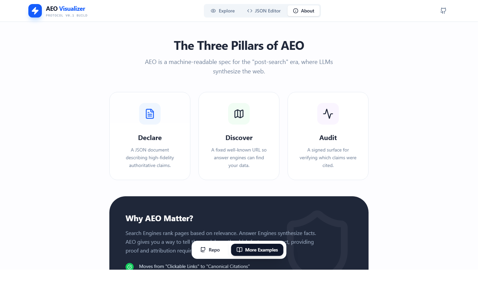
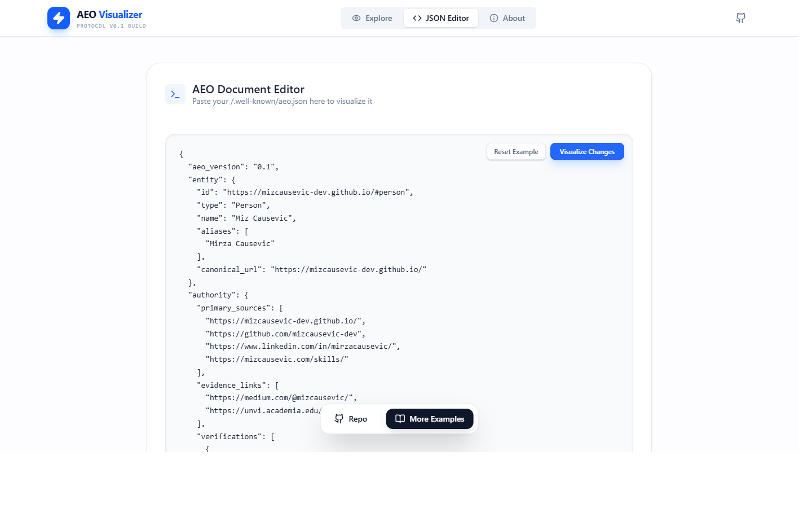

# AEO Protocol

A draft specification for making entity declarations **machine-readable, discoverable, and auditable** by answer engines.

> Above: the [AEO Protocol Visualizer](https://ai.studio/apps/27c8e83e-765f-4221-8238-a61df1f3e233) rendering the reference Person declaration at [mizcausevic-dev.github.io/.well-known/aeo.json](https://mizcausevic-dev.github.io/.well-known/aeo.json) — entity card, primary sources, verifications, and six authoritative claims.

The SEO era assumed humans typed queries into a search box and clicked blue links. The answer-engine era assumes an LLM composes a synthesized response in which a brand, person, product, or place may be cited, paraphrased, or omitted. AEO is the layer that lets an entity declare *what is authoritative about it*, *where to find that declaration*, and *how to verify it was used correctly*.

This repo is the v0.1 draft of the protocol, the JSON Schema that validates a conforming document, and three reference examples.

## The three pillars

| Pillar | What it does | File on your origin |
|---|---|---|
| **Declare** | One JSON document describing the entity, its authoritative claims, and citation preferences | `/.well-known/aeo.json` |
| **Discover** | A fixed well-known URL so any answer engine can find the declaration without bespoke crawling | Same path on every origin |
| **Audit** | A signature verifies declaration integrity; an optional endpoint can receive reports of cited claim IDs | Optional audit block in the document |

## Why not just JSON-LD / Schema.org?

Schema.org tells an answer engine *what is true about this page*. It does not tell the engine:

- **Which sources are canonical vs. stale** for a given entity
- **How the publisher wants to be attributed**
- **What freshness window applies to each claim**
- **Which claims must / must not appear in a synthesized answer**
- **How to verify the publisher endorsed the declaration**

AEO is built on top of JSON-LD vocabulary where useful (`schema.org` predicates are first-class), but it adds the **citation, freshness, and audit** semantics that synthesized-answer surfaces actually need.

## Why not llms.txt / ai.txt / robots.txt?

- **`robots.txt`** signals crawl rules. AEO signals citation and synthesis preferences to consumers that choose to honor them.
- **`llms.txt`** ([answer.ai proposal](https://llmstxt.org/)) suggests content to read. AEO declares what the publisher considers authoritative and how it prefers to be cited.
- **`ai.txt`** ([Spawning proposal](https://site.spawning.ai/spawning-ai-txt)) is opt-out signaling for training data. AEO is opt-in declaration for inference-time citation.

AEO is complementary to all three. A publisher should serve `robots.txt`, optionally serve `llms.txt`, and additionally serve `/.well-known/aeo.json` for citation-grade declarations.

## Quickstart

1. Write an `aeo.json` document conforming to [`aeo.schema.json`](aeo.schema.json). Start from one of the [examples](examples/).
2. Validate it with any JSON Schema 2020-12 validator (e.g. `ajv`, `jsonschema`).
3. Serve it at `https://your-origin/.well-known/aeo.json`. Use `Content-Type: application/aeo+json` if your host permits MIME override; `application/json` is also conforming.
4. (Optional, conformance Level 2+) Add a verification record and sign the declaration with a detached JWS.
5. (Optional, conformance Level 3) Expose an audit endpoint so consumers can post back which claims they cited.

To validate this repository's examples against its local schema, run `npm ci --ignore-scripts` and `npm test` with Node.js 20 or newer. The test also checks that an unsigned audit endpoint is rejected; it does not verify cryptographic signatures.

> The visualizer's JSON Editor view: paste any conforming `aeo.json` and see it render as an entity card with claims, authority, and citation preferences. Useful for authoring and debugging declarations before deploying.

## Files in this repo

- [`SPEC.md`](SPEC.md) — full v0.1 specification
- [`aeo.schema.json`](aeo.schema.json) — JSON Schema (draft 2020-12) for validation
- [`examples/aeo-person.json`](examples/aeo-person.json) — reference document for a Person entity
- [`examples/aeo-organization.json`](examples/aeo-organization.json) — reference document for an Organization entity
- [`examples/aeo-product.json`](examples/aeo-product.json) — reference document for a Product entity

## Reference implementations

Companion implementations of this draft. Check each repository for its current tests and release status:

| Repo | Stack | What it does |
|---|---|---|
| [aeo-sdk-python](https://github.com/mizcausevic-dev/aeo-sdk-python) | Python · pydantic v2 · httpx | Parse, build, validate, fetch. Sync and async. |
| [aeo-sdk-typescript](https://github.com/mizcausevic-dev/aeo-sdk-typescript) | TypeScript · zod · native fetch | Parse, build, validate, fetch. ESM-only, Node 18+. |
| [aeo-sdk-rust](https://github.com/mizcausevic-dev/aeo-sdk-rust) | Rust · serde · ureq (optional) | Parse, build, validate, fetch. Strict `deny_unknown_fields`. |
| [aeo-sdk-go](https://github.com/mizcausevic-dev/aeo-sdk-go) | Go · stdlib only | Parse, build, validate, fetch. Zero non-stdlib deps. |
| [aeo-cli](https://github.com/mizcausevic-dev/aeo-cli) | Rust · clap | `aeo validate`, `aeo fetch`, `aeo inspect`, `aeo claim`. Colored output. |
| [aeo-crawler](https://github.com/mizcausevic-dev/aeo-crawler) | Go · stdlib | BFS crawler — follows `primary_sources` to build an AEO declaration graph. Emits JSON Lines. |

The [examples](examples/) are the shared reference documents; conformance evidence belongs in each implementation repository.

## Status

**v0.1 draft.** Level 1 declarations can be schema-validated. Levels 2 and 3 remain design targets because the signing and audit profiles are not yet specified enough for interoperable verification. The protocol is not ratified by any standards body. Publishing a declaration does not establish that an answer engine will discover, honor, or cite it. Issues and pull requests welcome; substantive proposals should reference the conformance level they affect.

## License

MIT-licensed. The specification text, JSON Schema, and example documents in this repository may be freely implemented, extended, redistributed, or incorporated into commercial or non-commercial products with attribution. Reference implementations of this spec (such as [mcp-kinetic-gain](https://github.com/mizcausevic-dev/mcp-kinetic-gain)) are licensed separately under AGPL-3.0.

## Working interest

This protocol is part of a wider platform-engineering effort to give brands, products, and people first-class standing in the answer-engine era. Related work lives under the same author: [github.com/mizcausevic-dev](https://github.com/mizcausevic-dev).

## Kinetic Gain Protocol Suite

A family of open specifications for the answer-engine era. Each spec is a self-contained JSON document format with its own JSON Schema and reference examples; together they compose into an end-to-end account of entity, agent, prompt, tool, and citation.

| Spec | What it does |
|---|---|
| **[AEO Protocol](https://github.com/mizcausevic-dev/aeo-protocol-spec)** | Entity declaration at `/.well-known/aeo.json` — authoritative claims, citation preferences, audit hooks |
| [Prompt Provenance](https://github.com/mizcausevic-dev/prompt-provenance-spec) | Versioned, lineaged, reviewable LLM prompt records |
| [Agent Cards](https://github.com/mizcausevic-dev/agent-cards-spec) | Declarative agent capability and refusal disclosure |
| [AI Evidence Format](https://github.com/mizcausevic-dev/ai-evidence-format-spec) | Structured citations that travel with LLM-generated claims |
| [MCP Tool Cards](https://github.com/mizcausevic-dev/mcp-tool-card-spec) | Per-tool disclosure layered on Model Context Protocol servers |

---

**Connect:** [LinkedIn](https://www.linkedin.com/in/mirzacausevic/) · [Kinetic Gain](https://kineticgain.com) · [Medium](https://medium.com/@mizcausevic/) · [Skills](https://mizcausevic.com/skills/)
